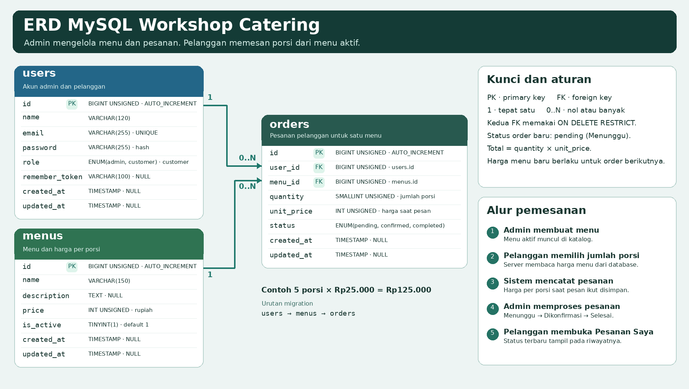

# PRD Workshop Catering

## Tujuan

Aplikasi pemesanan katering untuk praktik Laravel 13 dan MySQL selama 160 menit. Admin mengelola menu dan memproses pesanan. Pelanggan memesan porsi dari menu aktif dan memantau pesanan miliknya.

Alur demo berhasil saat admin membuat menu **Nasi Ayam Sambal Matah** seharga **Rp25.000**, pelanggan memesan **5 porsi** dengan total **Rp125.000**, lalu pelanggan melihat status **Dikonfirmasi** setelah admin memperbaruinya.

## Pengguna dan halaman

Pelanggan dapat mendaftar dengan email dan kata sandi. Admin memakai akun yang disiapkan untuk workshop. Akses tiap halaman dan aksinya diperiksa di server.

| Role | Halaman | Route | Perilaku |
|---|---|---|---|
| Admin | Kelola Menu | `GET /admin/menus` | Lihat daftar, tambah, edit, nonaktifkan, atau hapus menu yang belum pernah dipesan. Gunakan satu modal Blade untuk tambah/edit dan unggah foto opsional. |
| Admin | Pesanan Masuk | `GET /admin/orders` | Lihat seluruh pesanan, pelanggan, jumlah porsi, total harga, dan status. Konfirmasi pesanan menunggu, lalu tandai selesai. |
| Pelanggan | Katalog Menu | `GET /menus` | Lihat menu aktif dan harga per porsi. Pilih satu menu untuk dipesan. |
| Pelanggan | Form Pemesanan | `GET /menus/{menu}/order`, `POST /menus/{menu}/order` | Isi jumlah porsi dan kirim pesanan. Tampilkan pesan validasi di dekat input dan notifikasi hasil melalui SweetAlert2. |
| Pelanggan | Pesanan Saya | `GET /orders` | Lihat pesanan sendiri, jumlah, harga saat dipesan, total, dan status terkini. |

Pendukung CRUD menu: `POST /admin/menus`, `PATCH /admin/menus/{menu}`, dan `DELETE /admin/menus/{menu}`. Perubahan status pesanan: `PATCH /admin/orders/{order}/status`.

## Proses bisnis

1. Admin menambah menu dengan nama, harga per porsi, dan deskripsi opsional. Menu aktif tampil di katalog. Menu yang sudah dipesan dapat dinonaktifkan agar histori tetap utuh.
2. Pelanggan memilih satu menu dan mengisi jumlah porsi. Server mengambil identitas pelanggan dari sesi login, membaca kembali menu aktif dan harga dari database, lalu menyimpan pesanan berstatus **Menunggu**. Permintaan untuk menu nonaktif ditolak.
3. Admin melihat pesanan masuk dan memperbarui status dalam urutan **Menunggu → Dikonfirmasi → Selesai**. Perubahan status melalui jalur ini hanya tersedia untuk admin.
4. Pelanggan melihat status terbaru di **Pesanan Saya**. Total dihitung dari jumlah porsi dikali harga per porsi yang tercatat pada pesanan, sehingga pengubahan harga menu tidak mengubah total lama.

Satu pesanan memuat satu menu. Keranjang, pembayaran online, dan pengiriman berada di luar cakupan workshop.

## ERD MySQL

Diagram berikut menggambarkan skema tahap 1. Tahap 4 menambahkan `menus.image_path` tanpa mengubah relasi.

### Kamus data

| Tabel | Kolom | Tipe MySQL dan aturan |
|---|---|---|
| `users` | `id` | `BIGINT UNSIGNED`, PK, auto increment |
| | `name`, `email`, `password` | `VARCHAR(120)`, `VARCHAR(255)` UNIQUE, `VARCHAR(255)` untuk hash |
| | `role` | `ENUM('admin','customer')`, default `customer` |
| | `remember_token` | `VARCHAR(100)`, nullable |
| `menus` | `id` | `BIGINT UNSIGNED`, PK, auto increment |
| | `name`, `description` | `VARCHAR(150)`, `TEXT` nullable |
| | `price` | `INT UNSIGNED`, rupiah per porsi |
| | `is_active` | `TINYINT(1)`, default `1` |
| | `image_path` | `VARCHAR(255)`, nullable, path foto pada disk public |
| `orders` | `id` | `BIGINT UNSIGNED`, PK, auto increment |
| | `user_id`, `menu_id` | `BIGINT UNSIGNED`, FK ke `users.id` dan `menus.id`, `ON DELETE RESTRICT` |
| | `quantity` | `SMALLINT UNSIGNED`, jumlah porsi |
| | `unit_price` | `INT UNSIGNED`, harga per porsi saat dipesan dalam rupiah |
| | `status` | `ENUM('pending','confirmed','completed')`, default `pending` |
| Semua | `created_at`, `updated_at` | `TIMESTAMP`, nullable |

Kolom wajib diisi kecuali yang ditandai nullable atau memiliki default. Setiap order wajib punya satu pelanggan dan satu menu. Pelanggan dan menu masing-masing bisa memiliki nol atau banyak order. Role pelanggan diperiksa oleh aplikasi saat membuat order. FK menjaga keberadaan referensinya.

Validasi aplikasi pada tahap fitur membatasi `quantity` menjadi 1–65.535 dan `price` menjadi 1–4.294.967.295 sesuai tipe kolom. `unit_price` berasal dari `menus.price`. Model menghitung total melalui `totalPrice()`.

## Tahapan pengerjaan

1. **Tahap 1** — Sepakati PRD dan ERD, buat migration `users → menus → orders`, lalu selaraskan model `User`, `Menu`, dan `Order`.
2. **Persiapan praktik** — Siapkan login, pembatasan role, dan dua akun demo.
3. **Praktik fitur** — Bangun CRUD menu, katalog, form pemesanan, pesanan masuk, dan riwayat pelanggan dengan controller, model, Blade, dan service pemesanan.

Branch `main` menjadi titik awal peserta. Referensi tahap 1 tersedia di `dev-bintang`. Jalankan `php artisan migrate` dan `php artisan migrate:status` pada database MySQL lokal workshop setelah menyiapkan `.env`.
